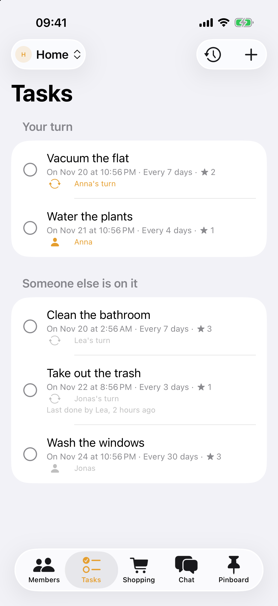
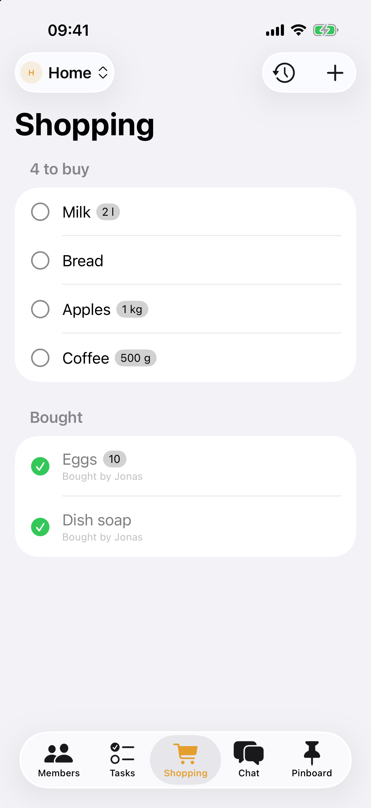
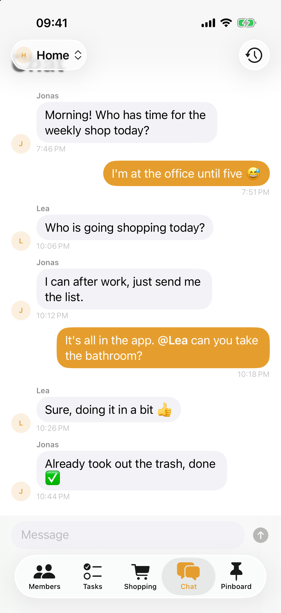
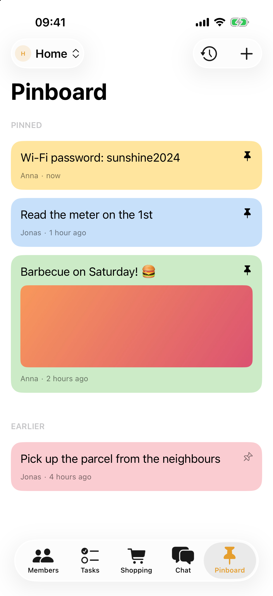
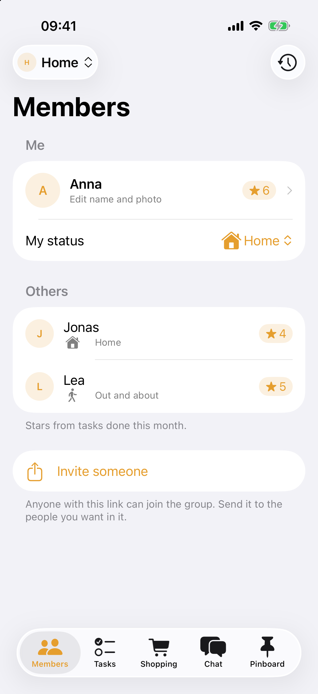

# Skep

One shared home for your household: shopping list, tasks, chat and pinboard. Create a group for your family, your partner or your flat share, invite people with a link, and everyone sees the same lists and messages. It syncs through your own iCloud, so there is no account to create.

<table>
  <tr>
    <td></td>
    <td></td>
    <td></td>
    <td></td>
    <td></td>
  </tr>
</table>

*The screenshots show demo data.*

## What it does
- **Shopping list:** add what is missing, tick it off in the shop, and attach a photo of the product.
- **Tasks:** one-off, repeating or on demand. Assign them, or let them rotate between members, with a deadline and a reminder.
- **Stars for effort:** each task has an effort in stars, and the Members tab shows everyone's stars for the month.
- **Group chat:** talk to the group and tag someone with @ to notify them.
- **Pinboard:** notes and photos for everyone, such as the Wi-Fi password or the plumber's number.
- **History:** who did what and when.

## Private by design
There is no Skep account and no Skep server. A group lives in iCloud and only its members can read it. Skep has no ads, no tracking and no analytics.

## Good to know
- Every member needs an iCloud account and must be signed in on the device.
- Available in English and German.
- Requires iOS 26 or later.

## Links
- [Privacy policy](https://loopmasta.github.io/skep/privacy)
- [Support](https://loopmasta.github.io/skep/support)
